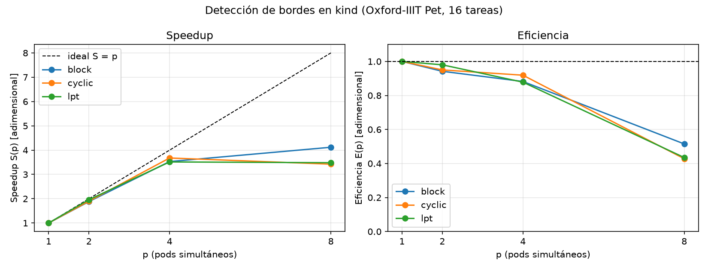
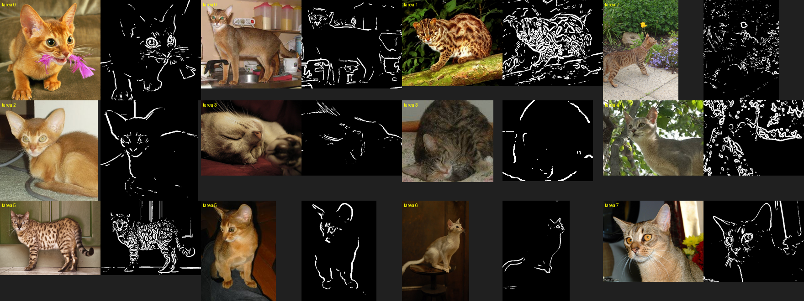

# Detección de bordes por lotes con Jobs indexados en Kubernetes

Proyecto de Cómputo de Alto Rendimiento. Un Job indexado de Kubernetes reparte
miles de fotos entre pods. Cada pod procesa su parte con el pipeline
**escala de grises → desenfoque gaussiano → Sobel → umbral**. Después medimos
cómo cambia el tiempo al subir el paralelismo y con tres estrategias de reparto.

- **Equipo 5.** Dataset: **Oxford-IIIT Pet** (37 razas de perros y gatos).
- **Clúster:** kind, con 1 control-plane y 3 workers en una sola laptop.
- **Examen** (clúster real con k3s en 3 laptops): carpeta [`examen/`](examen/).

## Estructura

```
app/
  worker.py          worker del Job: elige sus fotos según su índice y la estrategia
  merge.py           une las partes: resultados.csv, summary.json (desbalance) y mosaico.png
  Dockerfile         imagen bordes:1.0
  requirements.txt
k8s/
  kind-config.yaml.tpl   clúster kind con datos/ montada en /data de los 3 workers
  job.yaml.tpl           Job indexado (completionMode: Indexed, límites, backoffLimitPerIndex)
scripts/
  descargar-datos.sh     descarga el dataset en datos/entrada/ y escribe datos/dataset.env
  crear-cluster.sh       crea el clúster, construye la imagen y la carga en los nodos
  correr-job.sh          una corrida: lanza el Job, espera, mide T y une resultados
  demo.sh                corrida de demostración: 8 tareas, 4 en paralelo, 400 fotos y mosaico
  prueba-fallo.sh        el índice 3 falla en su primer intento; evidencia del reintento
  barrido.sh             las 36 corridas: 3 estrategias × p = 1, 2, 4, 8 × 3 repeticiones
  analyze.py             tabla T, S, E, f, I y gráficas
  descomponer.py         arranque de pods, contención de CPU y desbalance simulado
resultados/              tiempos.csv, tablas, gráficas, mosaico y evidencias
docs/reporte/            reporte técnico (LaTeX y PDF)
```

## Requisitos

| Componente | Versión mínima | Para qué |
|---|---|---|
| Docker Engine o Docker Desktop | 24 | construir la imagen y alojar los nodos de kind |
| kind | 0.23 | clúster local (probado con 0.33) |
| kubectl | 1.33 | `backoffLimitPerIndex` es GA desde 1.33 (probado con 1.37) |
| Python | 3.10 | `numpy`, `pillow` y `matplotlib` para unir resultados y graficar |
| envsubst, curl, tar | — | plantillas YAML y descarga del dataset |

Equipo: 4 núcleos, 8 GB de RAM y 4 GB libres en disco. En Windows, usar WSL 2.

```bash
pip install -r requirements.txt     # numpy, pillow y matplotlib para el host
```

## Reproducir todo desde cero

```bash
# 1. Datos: unos 790 MB. Las fotos no van en el repo
scripts/descargar-datos.sh pets

# 2. Prueba local, sin Kubernetes, simulando 4 índices
for i in 0 1 2 3; do
  JOB_COMPLETION_INDEX=$i TAREAS=4 ESTRATEGIA=lpt LIMITE=400 GUARDAR_BORDES=1 \
  ENTRADA=datos/entrada/images SALIDA=datos/salida/local python3 app/worker.py &
done; wait
python3 app/merge.py datos/salida/local datos/entrada/images --tareas 4

# 3. Clúster kind, imagen bordes:1.0 cargada en los nodos
scripts/crear-cluster.sh

# 4. Demostración: muestra en qué nodo corrió cada índice y arma el mosaico
scripts/demo.sh

# 5. Tolerancia a fallos: evidencia en resultados/fallo/
scripts/prueba-fallo.sh

# 6. Barrido de 36 corridas: resultados/tiempos.csv (unos 30 a 45 min)
scripts/barrido.sh

# 7. Análisis: tabla, gráficas y detalle por foto y por índice
python3 scripts/analyze.py --detalle datos/salida/b-block-p1-r1 --barrido resultados/barrido
python3 scripts/descomponer.py

# Borrar el clúster al terminar
scripts/crear-cluster.sh --borrar
```

`barrido.sh` se puede volver a lanzar si se corta: se salta las corridas que ya
están en `tiempos.csv`.

## Cómo funciona

1. **Datos compartidos.** kind monta la carpeta `datos/` del repo en `/data` de
   los 3 workers, y el Job la usa con un volumen `hostPath`. Las fotos están en
   `/data/entrada/images` y cada corrida escribe en `/data/salida/<corrida>/`.
2. **Job indexado.** Usa `completionMode: Indexed`, `completions: 16` y
   `parallelism: p`. Kubernetes crea pods con índices 0 a 15, como máximo p a la
   vez, y le pasa a cada uno su número en `JOB_COMPLETION_INDEX`.
3. **Worker.** Cada pod lista las fotos en el mismo orden alfabético y se queda
   con las suyas:
   - `block`: bloques contiguos de la lista.
   - `cyclic`: la foto *i* va a la tarea *i* mod 16.
   - `lpt`: de mayor a menor tamaño de archivo, cada foto va a la tarea con menos bytes acumulados.

   Un archivo dañado no detiene al pod: se registra como error. Cada pod
   escribe `part-XXXX.csv` (una fila por foto) y `part-XXXX.json` (tiempo de
   cómputo y nodo).
4. **Recursos.** Cada pod pide y tiene como límite 1 CPU y entre 256 y 512 MiB.
   Así, *p* pods usan como mucho *p* núcleos y el speedup se puede leer.
5. **Merge.** Une las partes en `resultados.csv` y `summary.json`, donde va el
   desbalance *I* = max(t_i) / promedio(t_i). Si se guardaron los bordes, arma
   `mosaico.png`.
6. **Tiempo de pared.** T(p) = `.status.completionTime − .status.startTime` del
   Job, con resolución de 1 s.

## Notas del dataset

El tar oficial (`images.tar.gz`) trae **7,390 archivos `.jpg`** y 3 `.mat`. La
tabla del curso dice 7,349 porque ese es el número de fotos con anotación. Aquí
se procesan todos los `.jpg`, y los que no se pueden abrir quedan como error en
`resultados.csv`.

## Resultados

Laptop: Ryzen 5 3550H, con 4 núcleos físicos y 8 hilos. Detalle en
[`resultados/tabla.md`](resultados/tabla.md),
[`resultados/descomposicion.md`](resultados/descomposicion.md) y el reporte
[`docs/reporte/reporte.pdf`](docs/reporte/reporte.pdf).

- **Escalamiento.** Es casi lineal hasta p = 4: S de 3.5 a 3.7 y E de 0.88 a
  0.92. Con p = 8 ya no mejora, porque cada foto tarda 2.75 veces más por la
  contención de CPU.
- **Arranque de pods.** Arrancar cada pod cuesta unos 4 s, que son el 51 % de T(1).
- **Costo por foto.** Se predice por megapíxeles (r = 0.95), no por tamaño de
  archivo (r = 0.50).
- **Desbalance.** LPT reparte mejor: I simulado de 1.065, contra 1.185 de block.




